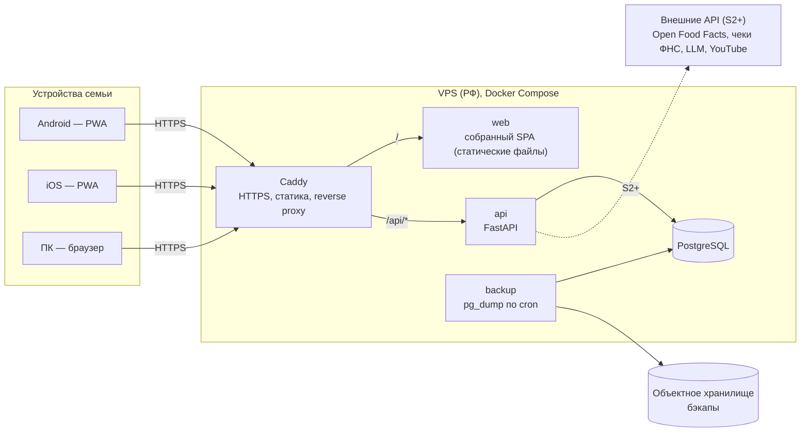
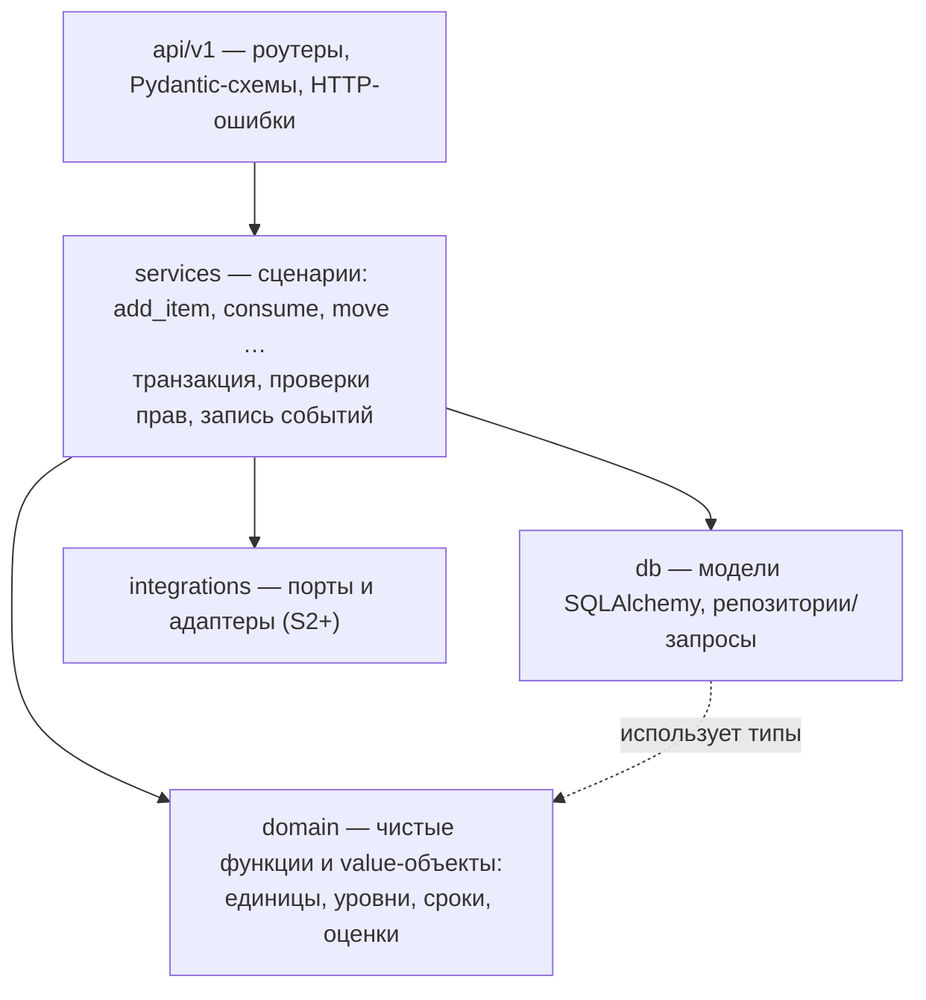

# 03. Архитектура

Диаграммы: [docs/diagrams/](diagrams/) (Mermaid, рендерятся на GitHub и в большинстве редакторов).

## 1. Обзор



Один домен, один origin: SPA и API отдаются с одного адреса (`https://zakroma.example.ru/` и `/api/v1/…`). Это убирает CORS и упрощает cookie-сессии.

## 2. Стек и обоснование

| Слой | Выбор | Почему | Альтернативы (отклонены) |
|---|---|---|---|
| Клиент | **PWA** | Один код для Android/iOS/ПК, установка без магазинов | Flutter/React Native — ×2–3 трудоёмкость без выгоды |
| UI-фреймворк | **React + TypeScript (strict) + Vite** | Крупнейшая экосистема, лучшая поддержка ассистентами | Vue/Svelte — тоже подходят, но меньше готовых решений |
| Стили | **Tailwind CSS** + headless-компоненты (Radix UI / shadcn/ui) | Быстро, доступность из коробки | MUI — тяжелее, «гугловый» вид |
| Данные на клиенте | **TanStack Query** | Кэш, повтор, инвалидация, офлайн-чтение | Redux — избыточен |
| Формы | **react-hook-form + zod** | Мало перерисовок, валидация схемами | — |
| Роутинг | **React Router** | Стандарт | — |
| PWA | **vite-plugin-pwa** (Workbox) | Манифест и service worker без ручной настройки | — |
| i18n | **react-i18next** | Стандарт, ленивые ресурсы | — |
| API-клиент | **openapi-typescript + openapi-fetch** (генерация из OpenAPI) | Типы всегда синхронны с backend | Ручные типы — дрейф |
| Backend | **Python 3.12+ + FastAPI** | Типизация через Pydantic, OpenAPI автоматически; лучшая экосистема для S2–S4 (LLM, разбор чеков) | Node/NestJS — один язык, но слабее для ML/LLM-задач |
| ORM / миграции | **SQLAlchemy 2 (async) + asyncpg + Alembic** | Зрелые, типизированные | Tortoise, SQLModel — менее зрелые |
| БД | **PostgreSQL 16+** | Реляционные данные, `pg_trgm` для поиска, `CHECK`-ограничения | SQLite — нет конкурентной записи и триграмм; NoSQL — неудобны связные запросы |
| Хэш паролей | **argon2-cffi** | Рекомендуемый алгоритм | bcrypt — допустим, но хуже |
| Пакеты Python | **uv** | Быстро, lock-файл | poetry |
| Пакеты JS | **pnpm** | Быстро, строгие зависимости | npm |
| Прокси/HTTPS | **Caddy** | Автоматические сертификаты, 10 строк конфига | nginx + certbot |
| Контейнеры | **Docker Compose** | Достаточно для одного сервера | Kubernetes — избыточен |
| CI/CD | **GitHub Actions** → GHCR → SSH-деплой | Бесплатно, привычно | — |

Конкретные версии фиксируются lock-файлами в момент создания каркаса (задача T-002/T-004), а не в документации.

## 3. Структура репозитория (монорепо)

```
zakroma/
├── CLAUDE.md                  # инструкция агенту
├── .claude/                   # команды и настройки Claude Code
├── docs/                      # вся документация (этот каталог)
├── templates/                 # шаблоны задач, ADR, уроков
├── tasks/                     # файлы задач T-xxx.md (история обсуждений)
├── backend/
│   ├── pyproject.toml
│   ├── alembic/               # миграции
│   ├── app/
│   │   ├── main.py            # создание FastAPI-приложения
│   │   ├── core/              # config, security, errors, logging
│   │   ├── domain/            # чистая логика: units, levels, expiry, consumption (без I/O)
│   │   ├── db/                # SQLAlchemy-модели, сессия, репозитории
│   │   ├── services/          # прикладные сценарии (use cases), транзакции
│   │   ├── api/
│   │   │   ├── deps.py        # current_user, household_member и т.п.
│   │   │   └── v1/            # роутеры по ресурсам + Pydantic-схемы
│   │   └── integrations/      # S2+: порты (Protocol) и адаптеры внешних API
│   ├── scripts/               # загрузка справочника и т.п.
│   └── tests/
│       ├── unit/              # domain, без БД
│       ├── integration/       # API + реальный Postgres
│       └── conftest.py
├── frontend/
│   ├── package.json
│   ├── src/
│   │   ├── app/               # провайдеры, роутер, layout
│   │   ├── api/               # сгенерированный клиент + хуки TanStack Query
│   │   ├── features/          # auth, households, inventory, catalog, attention …
│   │   ├── shared/            # ui-компоненты, утилиты, форматирование
│   │   ├── i18n/              # ресурсы ru/*.json
│   │   └── sw/                # настройки service worker
│   ├── e2e/                   # Playwright
│   └── public/                # иконки, manifest-ресурсы
├── deploy/
│   ├── docker-compose.yml     # prod
│   ├── docker-compose.dev.yml
│   ├── Caddyfile
│   └── backup/                # скрипты бэкапа и восстановления
└── .github/workflows/         # CI/CD
```

## 4. Backend: слои и правила зависимостей



Правила:

1. **`domain` не импортирует** FastAPI, SQLAlchemy, httpx и не обращается к времени/сети напрямую. «Сегодня» передаётся параметром. Это делает доменные тесты быстрыми и детерминированными.
2. **`api` тонкий**: валидирует вход, вызывает сервис, превращает результат в схему ответа. Бизнес-логики в роутерах нет.
3. **Одна транзакция на запрос** изменения; сервис записывает изменение состояния и событие журнала в одной транзакции.
4. **Внешние сервисы — только через порты** (`typing.Protocol`) в `integrations/`. В тестах подставляются фейки; реальные адаптеры проверяются отдельными (необязательными в CI) тестами.
5. **Права:** каждый маршрут `/households/{hid}/…` получает `HouseholdContext` через зависимость `require_member`, которая проверяет членство. Доступ к сущности по ID всегда фильтруется по `household_id` (защита от подстановки чужого ID).

### Ошибки

Формат — RFC 9457 `application/problem+json`:

```json
{ "type": "https://zakroma/errors/version-conflict", "title": "Данные изменились",
  "status": 409, "code": "version_conflict", "detail": "…", "current": { … } }
```

Поле `code` — стабильный машинный код; frontend переводит его через i18n.

### Время

- В БД: `timestamptz` для моментов, `date` для сроков годности и дат покупки.
- «Сегодня» для дома вычисляется в часовом поясе дома (`households.timezone`, по умолчанию `Europe/Moscow`).
- Сервисы получают текущее время из инжектируемого `Clock` — в тестах фиксируется.

### Конфигурация и наблюдаемость

- Настройки — `pydantic-settings` из переменных окружения (`.env` на сервере, `.env.example` в репозитории).
- Логи — JSON в stdout (structlog), `docker compose logs`. Идентификатор запроса в каждом логе.
- Ошибки — опционально GlitchTip/Sentry-совместимый DSN (этап «позже»).
- `GET /api/v1/health` — проверка БД; используется Caddy и деплоем.

## 5. Frontend

- **Feature-структура:** каждая фича (`inventory`, `attention`, `catalog` …) содержит свои компоненты, хуки запросов, роуты. Общие компоненты — в `shared/ui`.
- **Состояние сервера** — только TanStack Query (ключи вида `['household', hid, 'stock', filters]`). Локальное UI-состояние — `useState`/`useReducer`; глобального стора нет, пока не понадобится.
- **Оптимистичные обновления** для быстрых действий (−порция, смена уровня) с откатом при ошибке.
- **Конфликт 409** → тост «Кто-то уже изменил этот продукт» + подстановка актуальных данных.
- **Офлайн (MVP):** service worker кэширует оболочку; TanStack Query сохраняет кэш в IndexedDB (persist) — данные видны без сети; мутации без сети блокируются с сообщением.
- **Доступность:** headless-компоненты Radix, фокус-кольца, подписи у всех иконок-кнопок.

## 6. Аутентификация

Подробности — [ADR-0004](adr/0004-auth-simple-sessions.md).

- Серверные сессии: таблица `sessions` (хеш токена, срок, последний доступ). Cookie `zk_session`.
- Продление: если до истечения < 150 дней — срок сдвигается на 180 дней от текущего момента (не чаще раза в сутки).
- Приглашение: `household_invites` со случайным токеном (≥ 128 бит), срок 7 дней, может быть отозвано.
- Сброс пароля: `password_reset_tokens`, создаёт член того же дома, одноразовый, 24 часа. После сброса все сессии пользователя завершаются.

## 7. Интеграции будущих этапов (заготовка)

Все — за портами в `backend/app/integrations/`, включаются флагами в настройках.

| Порт | Этап | Кандидаты | Примечание |
|---|---|---|---|
| `BarcodeLookup` | S2 | Open Food Facts | Бесплатно; российских товаров мало → «память» кодов дома важнее |
| `ReceiptProvider` | S2 | API ФНС «Проверка чеков», сторонние сервисы проверки чеков | Условия доступа и квоты **перепроверить при старте задачи** |
| `LLMProvider` | S2–S4 | YandexGPT, GigaChat; зарубежные модели — через доступный из РФ шлюз | Зарубежные API (OpenAI, Anthropic, Google) **ограничивают доступ из России** — с российского VPS напрямую могут не работать. Выбор — отдельный ADR перед S2 |
| `VideoRecipeExtractor` | S4 | YouTube Data API (описание) + мультимодальная модель (видео) | Доступность YouTube и Gemini из РФ — риск; решение — при старте S4 |

Длительные операции (разбор чека, YouTube) — через таблицу заданий в Postgres и фоновый воркер (без Redis). Конкретная библиотека — ADR при старте S2.

## 8. Ключевые риски

| Риск | Влияние | Митигация |
|---|---|---|
| Семья перестаёт вести учёт | Проект бесполезен | Грубый учёт, быстрые действия, этап «ввод» сразу после MVP, пилот с обратной связью (T-044) |
| Потеря данных VPS | Высокое | Ежедневные бэкапы вне VPS + проверка восстановления |
| Недоступность LLM/YouTube из РФ | S2–S4 частично | Порты, российские LLM, ручной ввод всегда доступен |
| iOS-ограничения PWA | Низкое для MVP | Пуши не нужны; камера работает; инструкция «На экран Домой» |
| Дрейф между backend и frontend | Средне | Генерация клиента из OpenAPI + проверка в CI |
