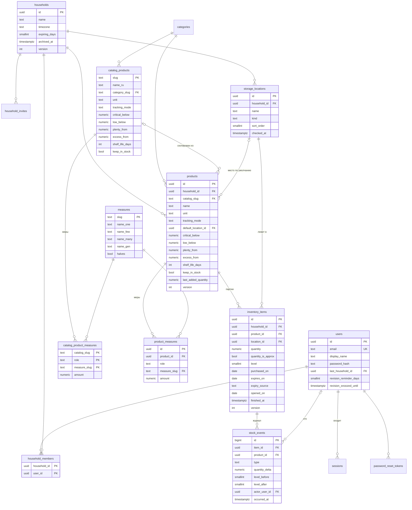

# 04. Модель данных

Проектная DDL MVP — [db/schema_design.sql](db/schema_design.sql) (проверена на PostgreSQL 16 и 18; инварианты — [db/schema_smoke_test.sql](db/schema_smoke_test.sql)). Реализованная схема (дамп после миграций) — [db/schema.sql](db/schema.sql). Решения — [ADR-0005](adr/0005-inventory-batches-and-event-log.md), [ADR-0006](adr/0006-quantity-levels-thresholds.md), [ADR-0007](adr/0007-household-products-from-catalog.md), [ADR-0013](adr/0013-presence-tracking-household-measures.md).

## 0. Что хранит модель и зачем

Модель отвечает на вопрос семьи **«что есть дома, чего нет и что купить»** ([01-vision](01-vision.md#миссия)):

| Вопрос | Откуда ответ |
|---|---|
| Что лежит и где | активные партии (`inventory_items`) по местам (`storage_locations`) |
| Сколько примерно | количество партии в базовой единице **или** уровень; показывается в бытовых мерах (`measures`, `product_measures`) |
| Чего нет и что купить | сводный уровень продукта и **норма дома** (`products.keep_in_stock` + `low_below`) |
| Что съесть первым | сроки партий (`expires_on`, `opened_on`) |
| Что подставить при покупке | «как в прошлый раз»: `products.default_location_id`, `last_added_quantity`, меры, типовой срок |
| Насколько учёт свежий | `storage_locations.checked_at` (проверка места); предложение ревизии — `users.revision_reminder_days`, `revision_snoozed_until` |
| На сколько хватит, сколько выбрасываем (S4) | журнал `stock_events`: покупки, закрытия, выбросы |

Записи «кто сколько съел» в модели возможны, но **не обязательны**: модель остаётся верной на одних отметках «закончилось», «мало» и покупках.

## 1. ER-диаграмма (MVP)



## 2. Таблицы

| Таблица | Назначение | Ключевые инварианты |
|---|---|---|
| `users` | Учётные записи; личная настройка предложения ревизии | email в нижнем регистре, уникален; период ревизии 7/14/21/28 дней или выключено |
| `sessions` | Серверные сессии | хранится только `sha256(token)` |
| `login_attempts` | Ограничение перебора | чистится задачей обслуживания (> 1 суток) |
| `households` | Дом/квартира; `people_count` — сколько человек едят дома (кнопка «на всех») | архивируется, а не удаляется |
| `household_members` | Членство (все равны) | PK (дом, пользователь) |
| `household_invites` | Ссылки-приглашения | хеш токена, срок, отзыв |
| `password_reset_tokens` | Ссылки сброса | одноразовые (`used_at`) |
| `categories` | Категории (глобально) | slug `^[a-z][a-z0-9_]*$` |
| `measures` | Словарь бытовых мер (глобально) | формы числа и падежа заполнены |
| `catalog_products` | Глобальный справочник | пороги упорядочены |
| `catalog_product_measures` | Меры позиции справочника | не больше одной меры `buy`; количество > 0 |
| `storage_locations` | Места хранения дома; `checked_at` — последняя проверка места | уникальное имя в доме (без учёта регистра и ё) |
| `products` | Продукты дома; норма дома (`keep_in_stock` + `low_below`); «как в прошлый раз» (`default_location_id`, `last_added_quantity`); род названия `name_gender` для «Закончился / Закончилась…» | один продукт на `catalog_slug` в доме; уникальное активное имя; пороги упорядочены |
| `product_measures` | Меры продукта дома (копия справочника, правится) | не больше одной меры `buy`; продукт того же дома |
| `inventory_items` | Партии | количество или уровень обязательно; `expiry_source='none'` ⇔ нет даты; продукт и место — того же дома |
| `stock_events` | Журнал изменений; `source = check` — отметка при проверке места или ревизии | только INSERT (триггеры); знак дельты соответствует типу |

## 3. Принадлежность дому

Каждая таблица данных дома содержит `household_id`, а ссылки между ними — **составные FK** `(household_id, X_id)`. База физически не позволит положить продукт дома A в место дома B, даже если в коде ошибка. Проверено тестом 1 в `schema_smoke_test.sql`.

Обязательное правило для запросов в коде: любая выборка по ID сущности дома фильтруется и по `household_id` из `HouseholdContext`.

## 4. Поиск

- `zk_search_norm(text)` — нижний регистр, `ё → е` (для уникальности названий).
- `zk_search_fold(text)` — то же + свёртка гласных, в которых чаще ошибаются: `о→а, э→е, я→а, ы→и`. Проверено на справочнике: «малако» → Молоко, «макорон» → Макароны, «памидор» → Помидоры, «гричка» → Гречка, «смитана» → Сметана.
- Сохраняемая вычисляемая колонка `search_text = zk_search_fold(название || ' ' || синонимы)` (синонимы через `|`).
- GIN-индекс `gin_trgm_ops`. Для короткого запроса против длинной строки используется **`word_similarity` / оператор `<%`**, а не `similarity`/`%` (последний не находит «макорон» в «макароны паста|макаронные изделия»).
- Запрос подсказок (эскиз; `:q` = `zk_search_fold(ввод)`):

```sql
WITH cand AS (
    SELECT 'product' AS kind, p.id::text AS ref, p.name AS name, p.search_text, 0.1 AS own_boost
    FROM products p
    WHERE p.household_id = :hid AND p.archived_at IS NULL
      AND (:q <% p.search_text OR p.search_text LIKE '%' || :q || '%')
    UNION ALL
    SELECT 'catalog', c.slug, c.name_ru, c.search_text, 0
    FROM catalog_products c
    WHERE (:q <% c.search_text OR c.search_text LIKE '%' || :q || '%')
      AND NOT EXISTS (SELECT 1 FROM products p
                      WHERE p.household_id = :hid AND p.catalog_slug = c.slug)
)
SELECT kind, ref, name
FROM cand
ORDER BY (CASE WHEN zk_search_fold(name) LIKE :q || '%' THEN 1 ELSE 0 END)  -- название начинается с запроса
         + word_similarity(:q, search_text) + own_boost DESC,
         length(name), name
LIMIT :limit;
```

- Порог `<%` — `pg_trgm.word_similarity_threshold` (по умолчанию 0.6); при реализации T-022 подобрать (ориентир 0.4) на тест-наборе опечаток из критериев приёмки задачи.
- Для запросов из 1–2 букв — только префиксный поиск (`LIKE :q || '%'`).
- Загрузчик справочника превращает пустые ячейки CSV в `NULL`, кроме `aliases` (→ `''`).

## 5. Миграции

- Alembic, имена ревизий `YYYYMMDD_HHMM_<описание>`.
- Проект и факт разделены: `docs/db/schema_design.sql` — проект всей схемы MVP (не теряется, правится только по согласованию), `docs/db/schema.sql` — дамп реальной БД после миграций.
- Первая миграция (T-003) — расширение `pg_trgm` и функции `zk_search_norm`/`zk_search_fold`. Таблицы переносятся из проекта в миграции задачами, которые вводят их модели (T-010, T-011, T-020, T-031…), DDL — как в `schema_design.sql`, если задача явно не меняет проект.
- Загрузка справочника — отдельная data-миграция, читающая `docs/catalog/*.csv` (upsert по `slug`, чтобы повторные загрузки обновляли справочник): категории, словарь мер (`measures.csv`), позиции (`products.csv`) и их меры (`product_measures.csv`).
- После каждой миграции схемы: `pg_dump --schema-only --no-owner` из dev-БД → обновить `docs/db/schema.sql` (команда — в шапке файла; задача DoD).
- Имена ограничений: соглашение `MetaData` повторяет имена Postgres по умолчанию (`<таблица>_pkey`, `_<колонки>_key`, `_fkey`, `_idx`); `CHECK` — только с явным именем.
- Удаление/переименование колонок — в два релиза (expand → contract).

## 6. Будущие таблицы (эскиз, уточняется в задачах)

| Этап | Таблица | Поля (основные) |
|---|---|---|
| S2 | `product_barcodes` | household_id, barcode, product_id, package_size, source (`manual`/`off`) — UK (household_id, barcode) |
| S2 | `receipts` | household_id, fiscal_key (ФН+ФД+ФП, UK), purchased_at, total, status, raw jsonb, created_by |
| S2 | `receipt_lines` | receipt_id, name_raw, quantity, price, matched_product_id, match_source, confirmed |
| S2 | `receipt_name_mappings` | household_id, name_normalized, product_id, package_size — «память» сопоставлений |
| S2 | `jobs` | type, payload jsonb, status, attempts, run_after, result jsonb — очередь фоновых задач |
| S3 | `recipes` | household_id, title, servings, steps jsonb, source_url, source_kind, created_by |
| S3 | `recipe_ingredients` | recipe_id, product_id или catalog_slug, quantity, unit, optional, note |
| S3 | `shopping_list_items` | household_id, product_id или free_text, quantity, added_by, checked_at |
| S4 | `video_recipe_cache` | video_id (UK), extracted jsonb, model, created_at |
| L | `user_identities` | user_id, provider (`yandex`/`telegram`), subject — внешний вход |
| L | `catalog_product_translations` | slug, locale, name, aliases — другие языки |
