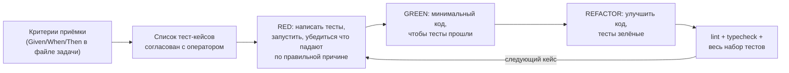

# 08. Тестирование

Принцип проекта: **сначала тест, потом реализация** (TDD). Ни одна задача не закрывается без тестов, покрывающих её критерии приёмки.

## 1. TDD-цикл в задаче



Правила для агента:

1. Тест-кейсы перечисляются в разделе «План тестов» файла задачи **до** написания кода и согласуются с оператором вместе с предложением.
2. Тесты пишутся и запускаются; вывод с падением («RED») фиксируется кратко в журнале задачи. Тест, который сразу зелёный, — подозрителен: проверить, что он вообще проверяет новое поведение.
3. Нельзя менять тест, чтобы он прошёл, без явного согласия оператора (кроме исправления ошибки в самом тесте — с пояснением).
4. Каждый баг исправляется через тест, воспроизводящий его.
5. Имена тестов отражают поведение и, где уместно, ID требования: `test_consume_more_than_left_clamps_and_closes_item__FR_INV_05`.

## 2. Пирамида

| Уровень | Что | Инструменты | Где | Скорость |
|---|---|---|---|---|
| Unit (domain) | Чистые функции: единицы, уровни, сроки, FEFO, оценки | pytest, `parametrize` из [тест-векторов](05-domain-rules.md), hypothesis для инвариантов | `backend/tests/unit/` | мс |
| Integration (API) | Эндпоинты + реальный Postgres: права, транзакции, события, конфликты версий | pytest, pytest-asyncio, httpx `AsyncClient`, testcontainers (Postgres) | `backend/tests/integration/` | секунды |
| Migration | Alembic upgrade на пустой БД; downgrade не поддерживаем; сверка моделей и миграций (`alembic check`) | pytest + alembic | `backend/tests/migrations/` | секунды |
| Frontend unit | Утилиты (форматирование количеств, дат), хуки | Vitest | `frontend/src/**/*.test.ts` | мс |
| Frontend component | Компоненты и экраны с моком API; доступность — `axe-core` через `expectAccessible` (`src/test/a11y.ts`), все общие компоненты — в `src/shared/ui/accessible.test.tsx` (T-008b) | Vitest + Testing Library + MSW + axe-core | `frontend/src/**/*.test.tsx` | мс–с |
| E2E | Критические сценарии в реальном браузере на собранном стеке | Playwright (Chromium + WebKit, мобильный viewport) | `frontend/e2e/` | минуты |

### Инварианты для property-based тестов (hypothesis)

- `level_from_quantity` монотонна: `q1 ≤ q2 ⇒ level(q1) ≤ level(q2)` (при `q1 > 0`).
- Перевод единиц туда-обратно не меняет значение.
- Сумма списаний по FEFO ≤ общего остатка; остаток никогда не отрицателен.
- `effective_expiry ≤ expires_on` всегда, когда оба заданы.

## 3. Обязательные интеграционные проверки безопасности

Для **каждого** нового маршрута `/households/{hid}/…`:

- запрос без cookie → `401`;
- запрос члена другого дома → `404`;
- запрос с ID сущности чужого дома в своём `hid` → `404`.

Это реализуется общей параметризованной фикстурой (задача T-010/T-031) — новые роутеры добавляются в её реестр.

## 4. E2E-сценарии MVP (T-043)

1. Регистрация → создан дом с 3 местами → «Добавить» → «Молоко» из «Обычно покупаете» или поиска → «Добавить 1 продукт» (место, «1 пакет» и срок «≈» подставлены) → видно в «Холодильнике».
2. Приглашение: пользователь A создаёт ссылку → B регистрируется по ней → B видит продукт A.
3. Отметка «Мало» и «Закончилось» из строки «Запасов» (2 нажатия) → продукт с нормой появляется в разделе «Всегда дома» → «Отменить» возвращает.
4. Продукт с истёкшим сроком появляется в «Сроках»; «Выбросить» убирает.
5. Конфликт: A и B меняют одну партию → второй видит сообщение и актуальные данные.
6. PWA: manifest валиден, service worker зарегистрирован, оболочка открывается офлайн.
7. «После магазина»: три продукта в списке, у одного изменено место → «Добавить 3 продукта» → все на своих местах; следующая покупка того же продукта подставляет новое место.

## 5. Данные для тестов

- Фабрики (factory-boy или простые функции-билдеры) в `backend/tests/factories.py`: `make_user`, `make_household`, `make_product(..., thresholds=…)`, `make_item`.
- Фиксированное время: фикстура `clock` с датой `2026-11-10 12:00 Europe/Moscow` (как в тест-векторах).
- **Изоляция ([ADR-0011](adr/0011-test-db-isolation.md), T-003):** один контейнер `postgres:18` на прогон (только `127.0.0.1`, случайный пароль), общая тестовая БД мигрируется до `head` один раз; каждый тест — в своей транзакции с откатом: фикстура `db_session` (`join_transaction_mode="create_savepoint"`, `commit()` приложения фиксирует только savepoint), приложение получает её через подмену `get_session` (фикстура `app`). Тесты миграций работают на отдельной пустой БД. Код с собственными соединениями (фоновые задачи) — `TRUNCATE … CASCADE` после теста, не `DELETE` (L-006).
- Фикстуры (`backend/tests/conftest.py`): `postgres`, `database_url`, `db_connection`, `db_session`, `clock`, `settings`, `app`, `client`; хелпер `tests.http.serve(app)` — клиент с запущенным lifespan (пул закрывается).
- Интеграционные и миграционные тесты требуют запущенного Docker; unit-тесты (`tests/unit`) — нет.
- Справочник в тестах — маленький фикстурный CSV, а не полный каталог (кроме одного теста загрузки полного каталога).

## 6. Покрытие и CI

| Область | Порог (CI падает ниже) |
|---|---|
| `backend/app/domain` | 90 % строк и ветвлений |
| `backend/app` в целом | 80 % |
| `frontend/src` (без сгенерированного API и UI-обёрток) | 70 % |

CI (T-006, [09-deployment §4.1](09-deployment.md#41-ci-на-каждый-pr-t-006)) на каждый PR в `main` и push в `main`: `pre-commit run --all-files` (ruff, eslint, prettier, gitleaks…), история git на секреты, `mypy --strict`, `pytest --cov` (порог 80 % в `pyproject.toml`), `tsc`, `pnpm test:coverage` (пороги 70 % в `vite.config.ts`), проверка, что сгенерированный API-клиент актуален (`pnpm api:check`: `openapi.json` из backend совпадает с закоммиченным, `schema.d.ts` — с `openapi.json`; локально то же ловят тест pytest и хук `openapi-fresh`), сборка frontend. E2E — на PR в `main` и ночью (T-043). Порог `app/domain` 90 % добавит T-030 вместе с каталогом.

## 7. Команды (после создания каркаса — уточнить в CLAUDE.md)

```bash
# backend
cd backend && uv run pytest                       # все тесты
cd backend && uv run pytest tests/unit -q         # быстрые
cd backend && uv run pytest -k fefo -x            # один набор
cd backend && uv run ruff check . && uv run mypy app

# frontend
cd frontend && pnpm test                          # vitest
cd frontend && pnpm test:coverage                 # vitest + пороги покрытия, как в CI
cd frontend && pnpm test:e2e                      # playwright
cd frontend && pnpm lint && pnpm typecheck
cd frontend && pnpm gen:api && pnpm api:check     # API-клиент из OpenAPI (T-005)

# весь стек локально
docker compose -f deploy/docker-compose.dev.yml up
```
