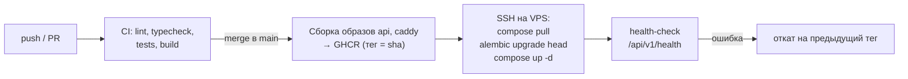

# 09. Развёртывание

Решение — [ADR-0002](adr/0002-hosting-ru-vps-docker-compose.md). Диаграмма — [diagrams/deployment.md](diagrams/deployment.md).

## 1. Инфраструктура

| Ресурс | Требование | Ориентир стоимости |
|---|---|---|
| VPS в РФ | 1–2 vCPU, 2 ГБ RAM, 20+ ГБ SSD, Ubuntu 24.04 LTS | 300–600 ₽/мес |
| Домен | `.ru` или поддомен существующего | ~200 ₽/год |
| Объектное хранилище (S3-совместимое, у того же или другого провайдера) | для бэкапов, < 1 ГБ | десятки ₽/мес |

Цены и тарифы проверяются при выборе провайдера (задача T-041), здесь — ориентиры.

## 2. Состав Docker Compose (prod)

| Сервис | Образ | Назначение |
|---|---|---|
| `caddy` | `caddy` | HTTPS (Let's Encrypt), раздача SPA, прокси `/api/*` → `api:8000`, gzip/zstd, заголовки безопасности |
| `api` | собственный (`backend/Dockerfile`) | FastAPI под uvicorn (2 воркера) |
| `db` | `postgres:16` (или новее) | Данные; том `pgdata` |
| `backup` | собственный маленький (postgres-client + rclone + age) | `pg_dump` по cron, шифрование, выгрузка в S3, ротация |

SPA собирается в образ `caddy` (multi-stage: `node` → статика → `caddy`), отдельный сервис `web` не нужен.

Caddyfile (эскиз):

```caddy
{$DOMAIN} {
    encode zstd gzip
    handle /api/* {
        reverse_proxy api:8000
    }
    handle {
        root * /srv/web
        try_files {path} /index.html
        file_server
    }
    header {
        Strict-Transport-Security "max-age=31536000"
        X-Content-Type-Options nosniff
        Referrer-Policy strict-origin-when-cross-origin
    }
    @sw path /sw.js /manifest.webmanifest
    header @sw Cache-Control "no-cache"
}
```

## 3. Подготовка сервера (однократно, T-041)

1. Создать VPS, добавить SSH-ключ, отключить вход по паролю.
2. `ufw`: открыть 22, 80, 443. Включить `unattended-upgrades`.
3. Установить Docker Engine и плагин Compose.
4. Создать пользователя `deploy` (группа `docker`), каталог `/opt/zakroma` с `docker-compose.yml`, `Caddyfile`, `.env`.
5. DNS: A-запись домена → IP VPS.
6. Первый запуск: `docker compose up -d`, проверить `https://<домен>/api/v1/health`.

`.env` (на сервере, не в git; шаблон — `deploy/.env.example`):

```
DOMAIN=zakroma.example.ru
POSTGRES_PASSWORD=…
DATABASE_URL=postgresql+asyncpg://zakroma:…@db:5432/zakroma
SESSION_SECRET=…
BACKUP_S3_ENDPOINT=… BACKUP_S3_BUCKET=… BACKUP_S3_KEY=… BACKUP_S3_SECRET=…
BACKUP_AGE_RECIPIENT=age1…
```

## 4. CI/CD



- Миграции выполняются **до** переключения на новый образ: `docker compose run --rm api alembic upgrade head`. Миграции пишутся совместимыми с предыдущей версией кода (expand → contract), чтобы откат образа был безопасен.
- Предыдущий тег хранится в `/opt/zakroma/.previous_tag` для отката.
- Секреты CI: `SSH_HOST`, `SSH_USER`, `SSH_KEY`, токен GHCR.
- Резервный вариант, если реестр недоступен с VPS: `git pull && docker compose build` на сервере (скрипт `deploy/deploy-local-build.sh`).

## 5. Бэкапы (NFR-REL-01/02)

- Ежедневно в 04:00 (время дома): `pg_dump -Fc` → шифрование `age` → выгрузка в S3 с именем `zakroma-YYYY-MM-DD.dump.age`.
- Ротация: 14 ежедневных, 8 еженедельных (воскресенье).
- Ключ расшифровки `age` хранится **вне** VPS (у оператора, в менеджере паролей).
- Ежемесячная проверка (чек-лист в `deploy/backup/RESTORE.md`): скачать последний бэкап → восстановить в локальный контейнер Postgres → проверить число продуктов/партий → записать дату проверки.

## 6. Мониторинг (минимальный)

- Внешний бесплатный пинг `/api/v1/health` раз в 5 минут с уведомлением в Telegram/почту (UptimeRobot или аналог, доступный из РФ).
- `docker compose logs --since 1h api` — первичная диагностика.
- Место на диске — предупреждение в скрипте бэкапа при заполнении > 80 %.

## 7. Локальная разработка

`deploy/docker-compose.dev.yml`: Postgres на `localhost:5432`, backend с `--reload` из исходников, frontend — `pnpm dev` (Vite) с прокси `/api` → `localhost:8000`. Cookie на `localhost` без флага `Secure` (настройка `COOKIE_SECURE=false` только в dev).

Тестовая среда для ручной проверки на телефоне: `pnpm dev --host` в локальной сети; для PWA-функций (service worker требует HTTPS) — проверка на prod/staging-поддомене.
