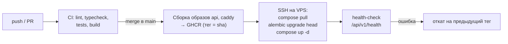

# 09. Развёртывание

Решение — [ADR-0002](adr/0002-hosting-ru-vps-docker-compose.md). Диаграмма — [diagrams/deployment.md](diagrams/deployment.md).

## 1. Инфраструктура

| Ресурс | Требование | Ориентир стоимости |
|---|---|---|
| VPS в РФ | 1–2 vCPU, 2 ГБ RAM, 20+ ГБ SSD, Ubuntu 24.04 LTS | 300–600 ₽/мес |
| Домен | `.ru` или поддомен существующего | ~200 ₽/год |
| Объектное хранилище (S3-совместимое, у того же или другого провайдера) | для бэкапов, < 1 ГБ | десятки ₽/мес |

Цены и тарифы проверяются при выборе провайдера (задача T-041), здесь — ориентиры.

## 2. Состав Docker Compose (prod, T-007)

Файлы: [`deploy/docker-compose.yml`](../deploy/docker-compose.yml), [`deploy/Caddyfile`](../deploy/Caddyfile), [`backend/Dockerfile`](../backend/Dockerfile), [`deploy/caddy.Dockerfile`](../deploy/caddy.Dockerfile), [`deploy/db-init/10-roles.sh`](../deploy/db-init/10-roles.sh). Один и тот же стек запускается локально и на VPS.

| Сервис | Образ | Назначение | Сети |
|---|---|---|---|
| `caddy` | `zakroma-caddy` (`caddy:2-alpine` + собранная SPA) | HTTPS, раздача SPA, прокси `/api/*` → `api:8000`, сжатие, кэш, заголовки безопасности; порты 80/443 | `web` |
| `api` | `zakroma-api` (`backend/Dockerfile`) | FastAPI под uvicorn, 2 воркера; роль БД `zakroma_app` | `web`, `db` |
| `migrate` | тот же `zakroma-api` | `alembic upgrade head` ролью `zakroma_owner`; `api` стартует только после его успешного завершения | `db` |
| `db` | `postgres:18` (по digest) | данные, том `pgdata`; роли создаёт `10-roles.sh` при первой инициализации тома | `db` |
| `backup` | — (T-042) | `pg_dump` по cron, шифрование, выгрузка в S3, ротация | `db` |

SPA собирается в образе `caddy` (multi-stage: `node` → `dist` → `caddy`), отдельный сервис `web` не нужен.

### 2.1. Безопасность стека

- **Сети.**
  - Наружу опубликованы только порты Caddy.
  - `db` — внутренняя сеть (`internal: true`): у базы нет выхода в интернет, к ней обращаются только `api` и `migrate`, Caddy её не видит.
  - Подсеть `web` закреплена (`172.30.250.0/24`): uvicorn доверяет `X-Forwarded-For` только оттуда — нужно для ограничения попыток входа (T-010).
- **Роли БД** (проверяет `tests/integration/test_db_roles.py`):

  | Роль | Права | Где пароль |
  |---|---|---|
  | `postgres` (суперпользователь) | только инициализация тома | у сервиса `db` |
  | `zakroma_owner` | владелец базы и схемы, миграции (в том числе `CREATE EXTENSION pg_trgm`); не суперпользователь | у `migrate` |
  | `zakroma_app` | `SELECT`/`INSERT`/`UPDATE`/`DELETE` на то, что создаёт владелец; DDL и подключение к базе `postgres` запрещены | у `api` |

  `10-roles.sh` выполняется **только на пустом томе**. Смена пароля роли: `docker compose exec db psql -U postgres -c "ALTER ROLE zakroma_app PASSWORD '…'"`, затем новый пароль в `.env` и `docker compose up -d`.
- **Контейнеры.**
  - Файловая система только для чтения (у api — `tmpfs /tmp`).
  - `cap_drop: ALL`; Caddy оставлен только `NET_BIND_SERVICE`.
  - `no-new-privileges`.
  - api работает от uid 10001.
  - Логи `json-file` ограничены: 3 файла по 10 МБ.
  - Базовые образы закреплены по digest, обновляет Dependabot. Major-версии — вручную: Postgres требует `pg_upgrade`, Node и Python меняются вместе с `.nvmrc` и `.python-version`.
- **Caddy** ([`Caddyfile`](../deploy/Caddyfile)):
  - HTTPS: Let's Encrypt для домена, внутренний CA для `127.0.0.1`; HTTP перенаправляется на HTTPS.
  - `X-Request-ID` ставит Caddy, значение клиента заменяется.
  - Заголовки: HSTS, `nosniff`, `Referrer-Policy: same-origin`, `Permissions-Policy` и CSP без `unsafe-inline`. Токены темы — конструируемая таблица стилей (`src/main.tsx`): элемент `<style>` строгий CSP блокирует.
  - Тело запроса к `/api` ≥ 1 000 000 байт → `413 payload_too_large`.
  - Access-лог выключен: в путях бывают токены приглашений; строку доступа пишет api, где путь заменён шаблоном маршрута.
  - `/assets/*` кэшируются на год, остальное — `no-cache`: новая версия доходит до семьи сразу.
- **Секреты.**
  - Только в `deploy/.env`: git-игнорируемый, права 0600, создаётся `init_prod_env.py`.
  - В compose — только ссылки `${…}`; каждому сервису передаётся только его пароль.
  - **Не запускайте `docker compose config` в CI и не публикуйте его вывод** — он печатает значения. Имена образов безопасно выводит `docker compose config --images`.
  - Пароль в окружении контейнера виден через `docker inspect` тем, у кого есть доступ к Docker. На сервере это равносильно root, поэтому группа `docker` — только у пользователя `deploy`.
- **OpenAPI** в prod не публикуется: `/api/v1/openapi.json` и `/api/v1/docs` → 404.

### 2.2. Проверка стека (smoke)

`backend/tests/smoke/test_prod_stack.py` — запросы через Caddy с проверкой TLS по корню внутреннего CA и проверки контейнеров: опубликованные порты, пользователь, файловая система только для чтения, отсутствие паролей в образах. Без `ZAKROMA_SMOKE_URL` модуль пропускается. В CI его запускает задача `prod stack` (§4.1).

### 2.3. Локальный запуск prod-сборки

```bash
cd backend && uv run python scripts/init_prod_env.py --site-address 127.0.0.1   # один раз: deploy/.env
docker compose -f deploy/docker-compose.yml up -d --build --wait                 # https://127.0.0.1:8443
docker compose -f deploy/docker-compose.yml cp caddy:/data/caddy/pki/authorities/local/root.crt caddy-root.crt
cd backend && ZAKROMA_SMOKE_URL=https://127.0.0.1:8443 ZAKROMA_SMOKE_CA=../caddy-root.crt \
  ZAKROMA_SMOKE_HTTP_URL=http://127.0.0.1:8080 ZAKROMA_SMOKE_COMPOSE_FILE=../deploy/docker-compose.yml \
  uv run pytest tests/smoke
docker compose -f deploy/docker-compose.yml down        # остановить; с -v — удалить и данные
```

- Адрес — `https://127.0.0.1:8443`, а не `localhost`. HSTS действует на весь хост без учёта порта, и браузер стал бы открывать по HTTPS все локальные проекты на `localhost`; на IP-адреса HSTS не распространяется.
- Браузер один раз предупредит о сертификате внутреннего CA. Это ожидаемо; при желании `caddy-root.crt` можно добавить в доверенные сертификаты текущего пользователя.
- `caddy-root.crt` в git не коммитится.
- Обновлять стек целиком: `up -d --build --wait` без имени сервиса. С именем compose не пересоздаёт уже запущенные зависимости.

## 3. Подготовка сервера (однократно, T-041)

1. Создать VPS, добавить SSH-ключ, отключить вход по паролю.
2. `ufw`: открыть 22, 80, 443. Включить `unattended-upgrades`. Опубликованные Docker порты обходят `ufw`, поэтому в compose они есть только у Caddy (80/443) — новые порты не добавлять.
3. Установить Docker Engine и плагин Compose.
4. Создать пользователя `deploy` (группа `docker`), каталог `/opt/zakroma` с копией репозитория (или файлами `deploy/` и образами из реестра — T-041).
5. DNS: A-запись домена → IP VPS.
6. Секреты: `python3 backend/scripts/init_prod_env.py --site-address <домен>` → `deploy/.env` (0600). Пароли не нужно никуда переписывать: для восстановления из бэкапа нужен ключ `age` (§5), а не пароли ролей.
7. Первый запуск: `docker compose -f deploy/docker-compose.yml up -d --build --wait`, проверить `https://<домен>/api/v1/health`.

Переменные `deploy/.env` перечислены в [`deploy/.env.example`](../deploy/.env.example). Переменные сессий и бэкапов добавят T-010 и T-042.

## 4. CI/CD



- Миграции выполняются **до** переключения на новый образ: сервис `migrate` (§2) завершается раньше, чем стартует новый `api`. Миграции пишутся совместимыми с предыдущей версией кода (expand → contract), чтобы откат образа был безопасен.
- Предыдущий тег хранится в `/opt/zakroma/.previous_tag` для отката.
- Секреты CI: `SSH_HOST`, `SSH_USER`, `SSH_KEY`, токен GHCR.
- Резервный вариант, если реестр недоступен с VPS: `git pull && docker compose build` на сервере (скрипт `deploy/deploy-local-build.sh`).
- Сборка образов и деплой — T-007, T-041; ниже — то, что уже работает.

### 4.1. CI на каждый PR (T-006)

Workflow [`.github/workflows/ci.yml`](../.github/workflows/ci.yml) запускается на PR в `main`, на push в `main` и вручную (Actions → CI → Run workflow). Задачи идут параллельно:

| Задача (имя проверки) | Что делает | Типичная причина красного |
|---|---|---|
| `pre-commit and secrets` | `pre-commit run --all-files` (ruff, eslint, prettier, YAML/JSON, gitleaks, справочник, `openapi-fresh`, actionlint) и `gitleaks-history` по всей истории | файл не отформатирован (дифф — в логе шага), устарел API-клиент (`pnpm gen:api`), секрет в коммите |
| `backend` | `uv sync --frozen`, `mypy --strict`, `pytest --cov` с интеграционными тестами на Postgres (testcontainers) | упавший тест, покрытие < 80 %, ошибка типов |
| `frontend` | `pnpm install --frozen-lockfile`, `typecheck`, `test:coverage` (≥ 70 %), `build`, `size` (≤ 300 КБ) | упавший тест, покрытие ниже порога, бандл вырос |
| `prod stack` (T-007) | `init_prod_env.py` → `docker compose up -d --build --wait` → smoke (§2.2) → `down -v` | сломан Dockerfile или Caddyfile, заголовок безопасности потерян, сервис не стал healthy (логи — в шаге после падения) |

Как читать красный прогон: PR → вкладка **Checks** → красная задача → первый красный шаг. Тот же шаг запускается локально той же командой (CLAUDE.md, «Команды»), у всех задач одинаковые версии инструментов: uv 0.13.5, Python из `backend/.python-version`, Node из `frontend/.nvmrc`, pnpm из `packageManager`.

Безопасность CI:

- токен только на чтение (`contents: read`), секретов нет — их и не нужно до деплоя (T-041);
- событие `pull_request` (не `pull_request_target`): PR из форков не получают прав;
- сторонние actions закреплены по SHA на версии старше 7 дней; обновляет Dependabot.

### 4.2. Dependabot (T-006)

[`.github/dependabot.yml`](../.github/dependabot.yml) по понедельникам предлагает обновления (GitHub Actions, uv в `backend/`, npm/pnpm во `frontend/`, базовые образы в `backend/` и `deploy/` — с T-007): minor и patch — одним PR на экосистему, каждый major — отдельно, свежий выпуск — не раньше чем через 7 дней. Major-версии образов и `@types/node` не предлагаются: Postgres требует `pg_upgrade`, Node и Python меняются вместе с `.nvmrc` и `.python-version`. Каждый PR проходит CI; merge — оператор, после чтения changelog для major.

### 4.3. Настройки репозитория (делает оператор, один раз)

**A. Оповещения и исправления уязвимостей.** Settings → **Advanced Security** (в старом интерфейсе — «Code security and analysis»):

1. **Dependency graph** — Enabled (у публичного репозитория включён по умолчанию).
2. **Dependabot alerts** — Enable.
3. **Dependabot security updates** — Enable: при уязвимости Dependabot сам откроет PR с исправленной версией.

**B. Права Actions.** Settings → Actions → General:

1. **Workflow permissions** — «Read repository contents and packages permissions».
2. «Allow GitHub Actions to create and approve pull requests» — выключено.
3. **Fork pull request workflows** — «Require approval for first-time contributors» (по умолчанию).

**C. Защита `main`** — после первого зелёного прогона CI на PR (до него GitHub не знает имён проверок). Settings → **Rules** → **Rulesets** → New ruleset → **New branch ruleset**:

1. Ruleset name: `main`; Enforcement status: **Active**; Bypass list — пусто.
2. Target branches → Add target → **Include default branch**.
3. Отметить правила:
   - **Restrict deletions**;
   - **Block force pushes**;
   - **Require a pull request before merging**, Required approvals: **0** (оператор один и не может одобрить свой PR; смысл правила — только через PR);
   - **Require status checks to pass** → Add checks: `pre-commit and secrets`, `backend`, `frontend`, `prod stack` (с T-007; добавить после её первого прогона); включить **Require branches to be up to date before merging** (CI проверяет именно то, что окажется в `main`).
4. **Create**.

Проверка: в PR с красной проверкой кнопка Merge недоступна; прямой `git push` в `main` отклоняется. Если CI сломан не по вине кода (сбой GitHub) — перезапустить задачу (Re-run failed jobs), а не отключать правило.

## 5. Бэкапы (NFR-REL-01/02)

- Ежедневно в 04:00 (время дома): `pg_dump -Fc` → шифрование `age` → выгрузка в S3 с именем `zakroma-YYYY-MM-DD.dump.age`.
- Ротация: 14 ежедневных, 8 еженедельных (воскресенье).
- Ключ расшифровки `age` хранится **вне** VPS (у оператора, в менеджере паролей).
- Ежемесячная проверка (чек-лист в `deploy/backup/RESTORE.md`): скачать последний бэкап → восстановить в локальный контейнер Postgres → проверить число продуктов/партий → записать дату проверки.

## 6. Мониторинг (минимальный)

- Внешний бесплатный пинг `/api/v1/health` раз в 5 минут с уведомлением в Telegram/почту (UptimeRobot или аналог, доступный из РФ).
- `docker compose logs --since 1h api` — первичная диагностика.
- Место на диске — предупреждение в скрипте бэкапа при заполнении > 80 %.

## 7. Локальная разработка

`deploy/docker-compose.dev.yml`: Postgres на `localhost:5432`, backend с `--reload` из исходников, frontend — `pnpm dev` (Vite) с прокси `/api` → `localhost:8000`. Cookie на `localhost` без флага `Secure` (настройка `COOKIE_SECURE=false` только в dev).

Тестовая среда для ручной проверки на телефоне: `pnpm dev --host` в локальной сети; для PWA-функций (service worker требует HTTPS) — проверка на prod/staging-поддомене.
