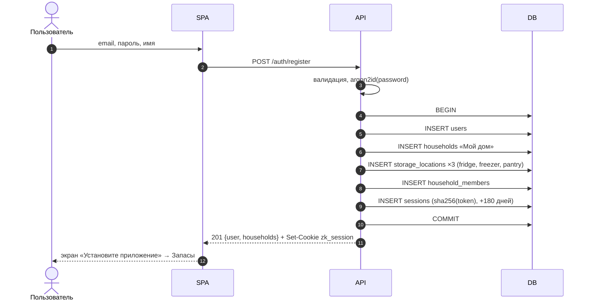
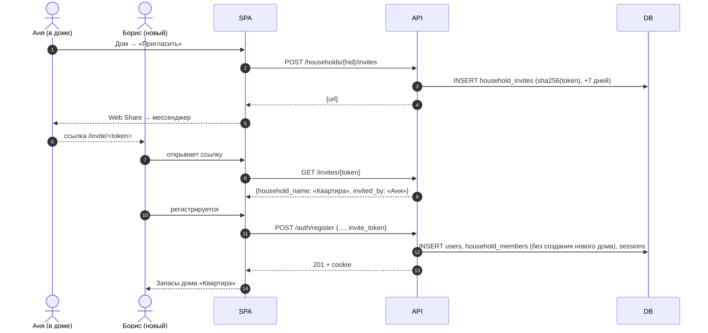
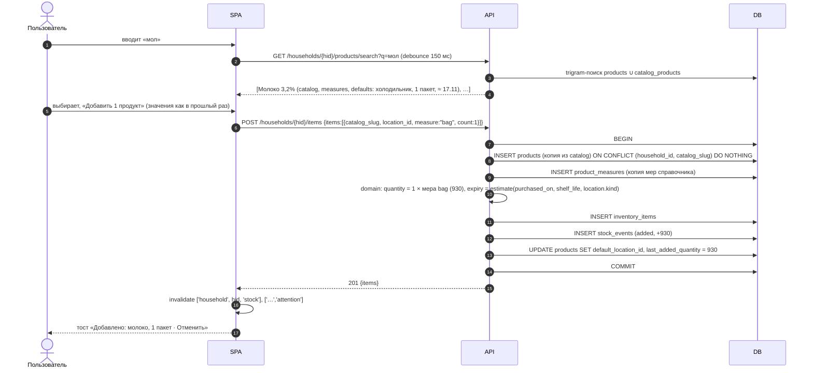
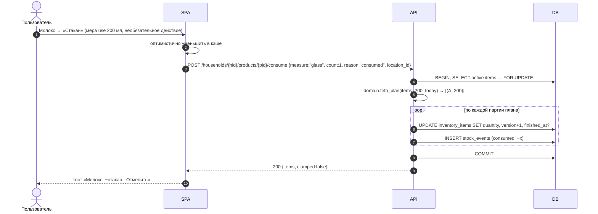
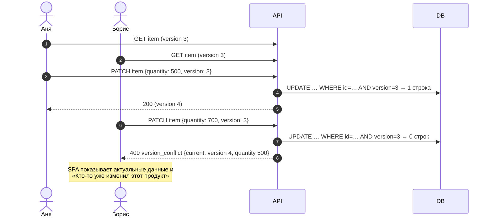
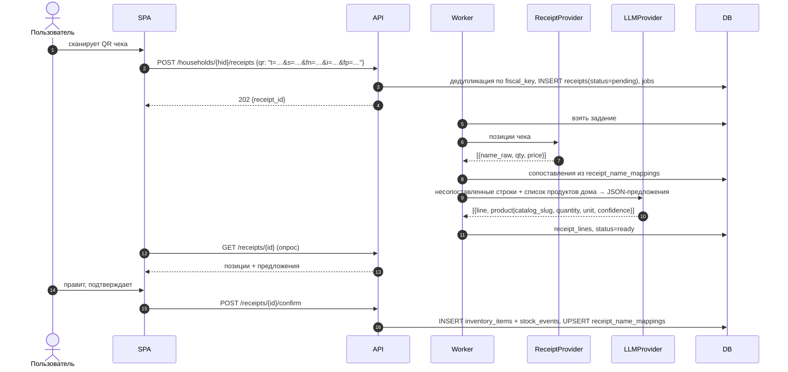
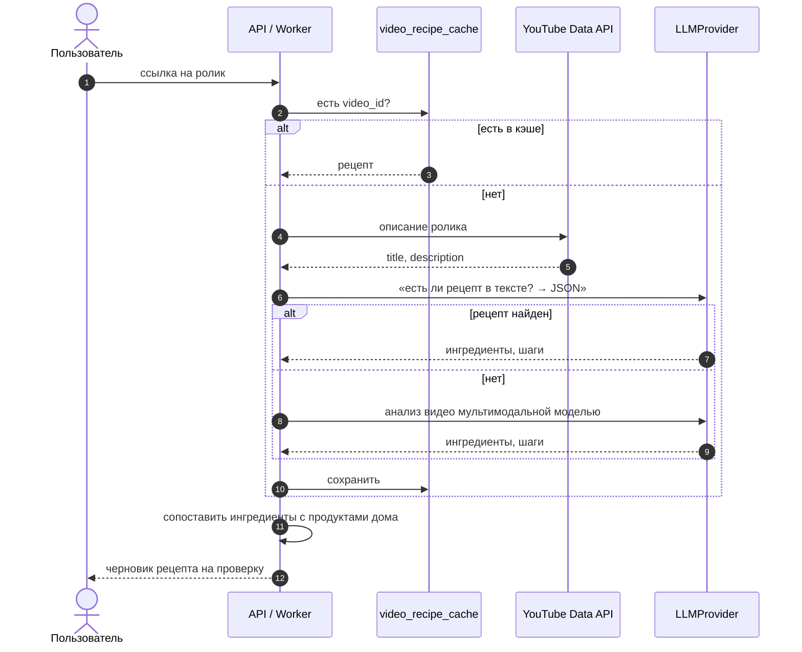

# Диаграммы последовательностей

## 1. Регистрация (без приглашения)

## 2. Приглашение члена семьи

## 3. Добавление продукта из справочника (первый раз)

## 4. Списание на уровне продукта (FEFO)

## 5. Конфликт версий

## 6. Чек по QR (S2, черновик)

## 7. Рецепт из YouTube (S4, черновик)

