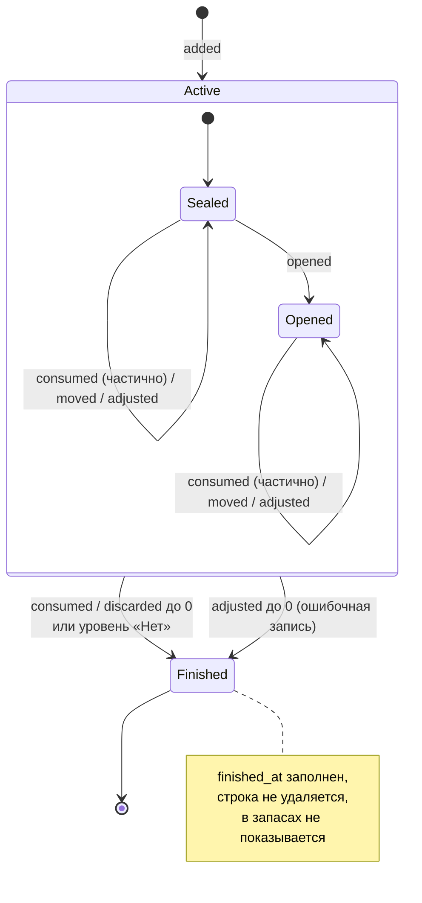
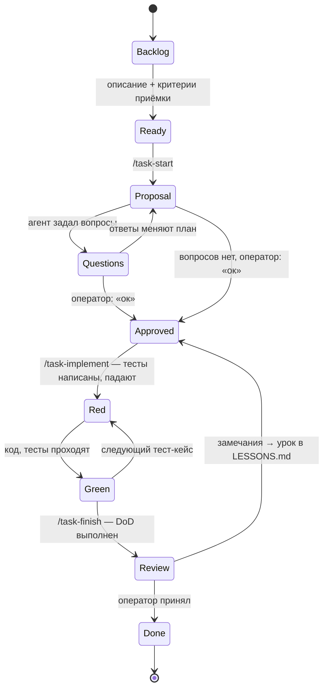

# Диаграммы состояний

## Партия (inventory_item)

Статус срока (вычисляется, не хранится): `unknown → ok → expiring → expired` по мере приближения `today` к эффективному сроку.

## Задача разработки (tasks/T-xxx.md)

